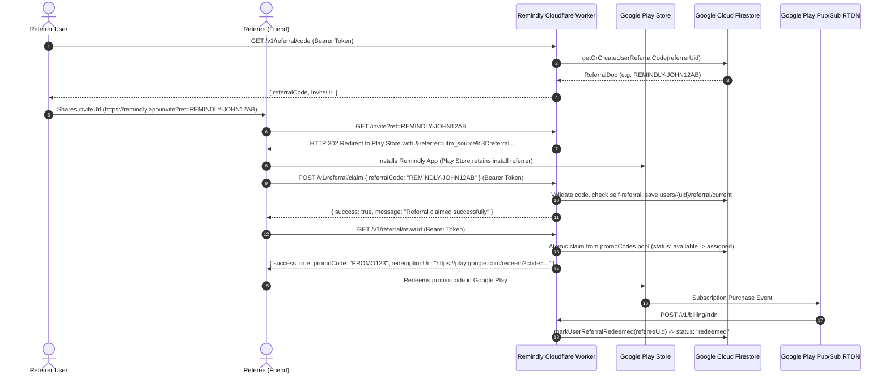
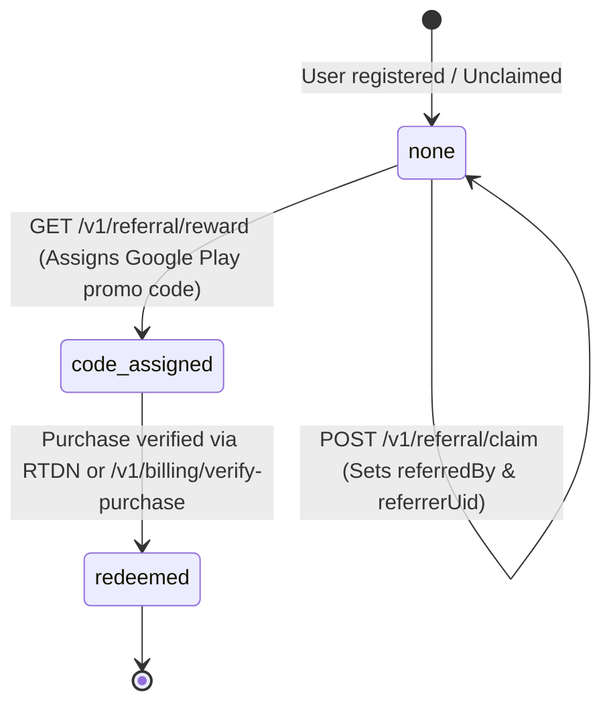

# Remindly Backend — Referral Program Specification

This document provides a comprehensive technical specification of the Referral and Install-Referrer reward system implemented in the Remindly Backend.

---

## 1. Executive Overview

The Remindly referral system is designed to drive viral user acquisition through organic sharing and Google Play Store install attribution. It rewards referred users with a free trial of Remindly Pro via Google Play subscription promo codes.

### Key Objectives
1. **Frictionless Sharing:** Provide users with unique, human-readable referral codes and web invite links (`https://<domain>/invite?ref=<CODE>`).
2. **Play Store Attribution:** Redirect web clicks directly to the official Google Play Store listing with Google Play Install Referrer parameters embedded.
3. **Automated Reward Distribution:** Safely allocate one-time Google Play subscription promo codes from a secure server-managed inventory without race conditions or code leakage.
4. **Fraud & Abuse Resistance:** Prevent self-referrals, duplicate claims, multi-referral hopping, and unauthorized access to the promo code pool.
5. **Subscription Lifecycle Synchronization:** Automatically mark promo codes and referral records as `redeemed` when Google Play RTDN (Real-Time Developer Notifications) or purchase verification detects an active subscription.

---

## 2. System Architecture & End-to-End Flow

### High-Level Workflow Diagram



---

## 3. Data Models & Firestore Schema

All referral data is stored in Google Cloud Firestore and managed through direct REST calls using a dedicated Google Service Account (`datastore` scope).

### 3.1 `referrals` Collection
Stores unique public referral codes generated by existing users.

- **Document Path:** `referrals/{referralCode}`
- **Document ID:** Normalized referral code (e.g. `REMINDLY-ALICE4F8A`)

```typescript
export interface ReferralDoc {
  userId: string;        // Firebase UID of the user who owns this code
  referralCode: string;  // Uppercase code string (e.g., "REMINDLY-JOHN12AB")
  createdAt: string;     // ISO 8601 UTC timestamp
}
```

### 3.2 `promoCodes` Collection
Maintains the pool of Google Play subscription promotional codes uploaded by administrators.

- **Document Path:** `promoCodes/{code}`
- **Document ID:** The promo code string (e.g. `PROMOXYZ12345678`)

```typescript
export type PromoCodeStatus = 'available' | 'assigned' | 'redeemed';

export interface PromoCodeDoc {
  code: string;                  // The alphanumeric promo code
  status: PromoCodeStatus;       // 'available' | 'assigned' | 'redeemed'
  assignedTo?: string | null;    // Firebase UID of the referee user
  assignedAt?: string | null;    // ISO 8601 UTC timestamp of allocation
  redeemedAt?: string | null;    // ISO 8601 UTC timestamp when subscription activated
  createdAt?: string;            // ISO 8601 UTC timestamp of creation/upload
}
```

### 3.3 `users/{uid}/referral/current` Document
Tracks the referral status and assigned reward for an individual user.

- **Document Path:** `users/{userId}/referral/current`
- **Document ID:** `current`

```typescript
export type UserReferralStatus = 'none' | 'code_assigned' | 'redeemed';

export interface UserReferralTracking {
  userId: string;                // Firebase UID of the tracked user
  referredBy?: string;           // Referral code claimed by this user
  referrerUid?: string;          // Firebase UID of the referrer who shared the code
  promoCodeAssigned?: string;    // Promo code string allocated to this user
  status: UserReferralStatus;    // 'none' -> 'code_assigned' -> 'redeemed'
  claimedAt?: string;            // ISO timestamp when referral link was claimed
  assignedAt?: string;           // ISO timestamp when promo code reward was assigned
  redeemedAt?: string;           // ISO timestamp when Google Play confirmed redemption
  updatedAt: string;             // ISO timestamp of last update
}
```

---

## 4. Endpoints & Route Specifications

### 4.1 `GET /invite`
Browser-facing redirect route. Captures web clicks and forwards users to Google Play with referrer tracking.

- **Authentication:** None (Public).
- **Query Parameters:**
  - `ref` *(string, optional)*: The referral code (e.g. `REMINDLY-JOHN12`).
- **Headers:** Standard browser request headers (`User-Agent`, `CF-Connecting-IP`).
- **Response:** `302 Found` with `Location` header.
- **Destination Format:**
  ```
  https://play.google.com/store/apps/details?id=com.victorkirui.remindly&referrer=utm_source%3Dreferral%26utm_content%3D<ref>%26ref%3D<ref>
  ```
- **Telemetry & Logging:**
  - Emits structured JSON log event `referral_invite_click` containing `referralCode`, `destination`, `userAgent`, and `ip`.
  - Records operation in server logs (`endpoint: '/invite'`, `statusCode: 302`).
- **Cloudflare Routing Requirement:**
  - Requires `"run_worker_first": true` in `wrangler.jsonc` to bypass Cloudflare's static asset SPA routing.

---

### 4.2 `GET /v1/referral/code` (alias: `POST /v1/referral/code`)
Generates or retrieves the authenticated user's personal referral code and invite link.

- **Authentication:** Required (`Authorization: Bearer <firebase-id-token>`).
- **Request Body:** None.
- **Logic:**
  1. Checks if a referral document already exists for `userId` in `referrals` collection.
  2. If found, returns existing code.
  3. If not found, generates a new deterministic/random code:
     - Uses first 5 alphanumeric characters of user's display name or first 4 of UID.
     - Appends 4 random uppercase alphanumeric characters.
     - Format: `REMINDLY-<PREFIX><SUFFIX>` (e.g. `REMINDLY-VICT12AB`).
  4. Resolves base origin from `env.APP_URL` (falls back to request `url.origin`).
  5. Stores record in `referrals/{code}`.
- **Response (200 OK):**
  ```json
  {
    "success": true,
    "referralCode": "REMINDLY-VICT12AB",
    "inviteUrl": "https://remindly-backend.victorkirui.workers.dev/invite?ref=REMINDLY-VICT12AB"
  }
  ```

---

### 4.3 `POST /v1/referral/claim`
Links a newly installed referee user to their referrer. Typically called by the Android client on first launch after reading the Google Play Install Referrer.

- **Authentication:** Required (`Authorization: Bearer <firebase-id-token>`).
- **Request Headers:** `Content-Type: application/json`
- **Request Body:**
  ```json
  {
    "referralCode": "REMINDLY-VICT12AB"
  }
  ```
- **Validation & Business Rules:**
  1. **Required:** `referralCode` must be non-empty after trimming. Returns `400 Bad Request` if missing.
  2. **Code Existence:** Looks up code in `referrals` collection (by document ID and field query fallback). Returns `404 Not Found` (`"Referral code not found."`) if invalid.
  3. **Self-Referral Prevention:** Rejects if `referral.userId === request.user.uid`. Returns `400 Bad Request` (`"Users cannot claim their own referral code."`).
  4. **Idempotency:** If the user already claimed this exact referral code previously, returns `200 OK` (`"Referral claimed successfully"`) without error.
  5. **Anti-Hopping:** If the user has already claimed a *different* referral code, returns `400 Bad Request` (`"Referral has already been claimed by this user."`).
- **Response (200 OK):**
  ```json
  {
    "success": true,
    "message": "Referral claimed successfully",
    "referrerUid": "referrer-firebase-uid-12345"
  }
  ```

---

### 4.4 `GET /v1/referral/reward`
Allocates an unused Google Play subscription promo code from the inventory and assigns it to the authenticated referee user.

- **Authentication:** Required (`Authorization: Bearer <firebase-id-token>`).
- **Prerequisites:** User must have previously claimed a referral code via `POST /v1/referral/claim`.
- **Validation & Business Rules:**
  1. Checks `users/{uid}/referral/current`. If no record or `referredBy` is missing, returns `400 Bad Request` (`"No referral record found for this user."`).
  2. If user already has `status: "code_assigned"`, `status: "redeemed"`, or non-empty `promoCodeAssigned`, returns `400 Bad Request` (`"Referral reward has already been claimed."`).
  3. Queries Firestore for up to 5 promo codes with `status: "available"`. If none available, returns `404 Not Found` (`"No promo codes available"`).
- **Concurrency & Atomic Allocation:**
  - Uses Firestore REST `documents:commit` API with conditional writes:
    - **Promo Doc Write:** Sets `status: "assigned"`, `assignedTo: userId`, `assignedAt: now`, conditioned on `currentDocument.updateTime` (optimistic lock).
    - **User Doc Write:** Updates `users/{uid}/referral/current` with `promoCodeAssigned: code`, `status: "code_assigned"`, `assignedAt: now`.
  - If another concurrent request claims the candidate code first, the commit fails precondition and the algorithm automatically retries with the next candidate.
- **Response (200 OK):**
  ```json
  {
    "success": true,
    "promoCode": "PROMO9876543210ABC",
    "redemptionUrl": "https://play.google.com/redeem?code=PROMO9876543210ABC"
  }
  ```

---

### 4.5 `GET /v1/referral/status`
Returns the complete referral tracking state for the authenticated user, including their referee status and their own referrer code.

- **Authentication:** Required (`Authorization: Bearer <firebase-id-token>`).
- **Response (200 OK):**
  ```json
  {
    "success": true,
    "referral": {
      "userId": "firebase-uid",
      "referredBy": "REMINDLY-JOHN12AB",
      "referrerUid": "referrer-uid-123",
      "promoCodeAssigned": "PROMO9876543210ABC",
      "status": "code_assigned",
      "claimedAt": "2026-10-19T10:00:00.000Z",
      "assignedAt": "2026-10-19T10:05:00.000Z",
      "redeemedAt": null,
      "updatedAt": "2026-10-19T10:05:00.000Z"
    },
    "myReferralCode": "REMINDLY-MYCODE99"
  }
  ```
  *(If user was not referred by anyone, `referral` is `null`).*

---

### 4.6 `POST /v1/admin/promo-codes/upload`
Administrative bulk upload endpoint for adding new quarterly batches of Google Play subscription promo codes.

- **Authentication:** Required header `X-Analytics-Key: <ANALYTICS_ADMIN_KEY>`.
- **Request Headers:** `Content-Type: application/json`
- **Request Body:**
  ```json
  {
    "codes": [
      "PROMOCODE12345678",
      "PROMOCODE87654321"
    ]
  }
  ```
- **Processing Logic:**
  - Strips quotes, whitespace, and comment lines.
  - Normalizes to uppercase.
  - Validates alphanumeric format (`/^[A-Z0-9]{8,40}$/`).
  - Deduplicates codes within the incoming payload.
  - Commits in batches of 100.
  - **Non-destructive:** Checks if code already exists in Firestore; existing codes are skipped to preserve `assigned` or `redeemed` statuses.
- **Response (200 OK):**
  ```json
  {
    "success": true,
    "data": {
      "added": 250,
      "skipped": 12,
      "total": 262
    }
  }
  ```

---

## 5. Lifecycle State Transitions

The referral status in `users/{uid}/referral/current` progresses through a strict one-way state machine:



### State Definitions
| State | Description | Allowed Actions |
|---|---|---|
| `none` | User has not claimed a referral code, or has claimed a referral code but has not yet requested a promo code reward. | Can claim referral code (`POST /v1/referral/claim`). Can request reward if `referredBy` is present (`GET /v1/referral/reward`). |
| `code_assigned` | A Google Play promo code has been atomically allocated to the user. | User can retrieve code/redemption URL via status check. Cannot claim another reward. |
| `redeemed` | The user activated the Google Play subscription using the promo code; confirmed by Google Play Billing backend. | Final terminal state. Cannot claim new reward or modify referral record. |

---

## 6. Google Play Subscription Synchronization

The referral reward lifecycle is tightly coupled with Google Play Billing:

1. **Promo Code Redemption:** When the referee clicks `redemptionUrl`, Google Play applies the code to Remindly Pro subscription (e.g. 1 month free trial).
2. **Purchase Verification (`POST /v1/billing/verify-purchase`):**
   - When the user returns to the app and validates their purchase token, the server verifies the entitlement with Google Play Developer API.
   - If `entitlement.tier === 'premium'`, the Worker schedules background execution:
     ```typescript
     ctx.waitUntil(markUserReferralRedeemed(user.uid).catch(() => undefined));
     ```
3. **Real-Time Developer Notifications (`POST /v1/billing/rtdn`):**
   - Cloud Pub/Sub pushes subscription events to `/v1/billing/rtdn`.
   - The worker decodes the notification, retrieves the purchase, updates `users/{uid}/billing/current`, and triggers:
     ```typescript
     ctx.waitUntil(markUserReferralRedeemed(entitlement.userId).catch(() => undefined));
     ```
4. **`markUserReferralRedeemed(userId)` Implementation:**
   - Verifies `users/{uid}/referral/current.status === 'code_assigned'`.
   - Updates `users/{uid}/referral/current`: `status: 'redeemed'`, `redeemedAt: now`.
   - Updates `promoCodes/{code}`: `status: 'redeemed'`, `redeemedAt: now`.

---

## 7. Security, Access Control & Anti-Abuse

### 7.1 Firestore Security Rules (`firestore.rules`)
```javascript
// Referral tracking document: read by owner, written only by Worker Service Account
match /users/{uid}/referral/{documentId} {
  allow read: if isOwner(uid);
  allow write: if false;
}

// Public referral codes: read by authenticated users, written only by Worker
match /referrals/{referralId} {
  allow read: if signedIn();
  allow write: if false;
}

// Promo code inventory: completely hidden from client SDKs
match /promoCodes/{codeId} {
  allow read, write: if false;
}
```

### 7.2 Fraud Prevention Measures
1. **Self-Referral Guard:** Direct equality check between token UID and referrer UID prevents users from claiming their own code.
2. **Single Referral Claim:** Users cannot overwrite an existing referrer claim with a different code.
3. **Direct Pool Protection:** The `promoCodes` collection is write-protected from client requests and can only be modified by the Worker via OAuth2 service account tokens.
4. **Rate Limiting & Admin Key:** Uploads and pool modifications are gated behind `ANALYTICS_ADMIN_KEY`.

---

## 8. Cloudflare Worker Routing Configuration

To allow the browser invite redirect (`GET /invite`) to operate alongside the static React testing frontend, [`wrangler.jsonc`](file:///d:/Projects/remindly-backend/wrangler.jsonc) specifies `run_worker_first`:

```jsonc
{
  "name": "remindly-backend",
  "main": "src/worker/index.ts",
  "compatibility_date": "2026-09-02",
  "compatibility_flags": ["nodejs_compat"],
  "vars": {
    "APP_URL": "MY_APP_URL",
    "FIREBASE_PROJECT_ID": "remindly-9678a",
    "GOOGLE_PLAY_PACKAGE_NAME": "com.victorkirui.remindly",
    "ALLOW_DEV_AUTH": "false"
  },
  "assets": {
    "directory": "./dist",
    "binding": "ASSETS",
    "not_found_handling": "single-page-application",
    "run_worker_first": true
  }
}
```

### Routing Execution Order:
1. Incoming request hits Worker `fetch()` first.
2. If `pathname === '/invite'`, Worker executes 302 redirect.
3. If `pathname` matches API routes (`/v1/*`), Worker executes endpoint logic.
4. If no worker route matches (e.g. `/`, `/assets/*`), Worker delegates to static assets via `env.ASSETS.fetch(request)`.

---

## 9. Operations & Verification Tooling

### 9.1 CLI Promo Code Uploader
Upload local files containing promo codes directly into Firestore:
```bash
# Upload default ./promo-codes file
npm run upload-promo-codes

# Upload a custom exported CSV file
npm run upload-promo-codes -- ./path/to/codes.csv
```

### 9.2 Automated Integration Test Suite
Run the 11-stage end-to-end integration test against a local or remote backend:
```powershell
# Against local dev worker:
powershell -File scripts/test-referral.ps1 -BaseUrl "http://127.0.0.1:8787"

# Against deployed worker:
powershell -File scripts/test-referral.ps1 -BaseUrl "https://<your-worker-domain>"
```

#### Test Stages Executed:
1. `GET /v1/referral/code` — Generates unique referral code & invite URL.
2. `GET /invite?ref=...` — Verifies HTTP 302 redirect & Play Store destination.
3. `POST /v1/referral/claim` (Self-referral) — Verifies HTTP 400 rejection.
4. `POST /v1/referral/claim` (Invalid code) — Verifies HTTP 404 rejection.
5. `GET /v1/referral/reward` (Unreferred user) — Verifies HTTP 400 rejection.
6. `POST /v1/referral/claim` (Valid claim) — Verifies successful attribution.
7. `POST /v1/referral/claim` (Idempotent retry) — Verifies HTTP 200 safe duplicate claim.
8. `POST /v1/referral/claim` (Conflicting secondary claim) — Verifies HTTP 400 rejection.
9. `GET /v1/referral/status` — Verifies state before reward.
10. `GET /v1/referral/reward` — Verifies atomic promo code allocation & redemption URL.
11. `GET /v1/referral/reward` (Duplicate claim) — Verifies HTTP 400 rejection.

---

## 10. Latency & Concurrency Optimizations

To prevent client-side timeouts during mobile first-launch attribution (which typically operate on strict client timeout budgets), the referral subsystem employs the following performance patterns:

1. **Lazy Entitlement Resolution:**
   - The global authentication pipeline uses `resolveEntitlement()` on-demand.
   - Endpoints that do not require subscription tier gating (`/v1/referral/claim`, `/v1/referral/reward`, `/v1/referral/code`, `/v1/referral/status`) bypass the synchronous `users/{uid}/billing/current` Firestore lookup entirely, eliminating ~150–200ms of latency per request.

2. **Parallelized Independent Reads:**
   - In `claimReferral()`, `getReferralByCode(cleanCode)` and `getUserReferralTracking(userId)` are executed concurrently via `Promise.all()`, shaving off a full sequential network round-trip (~150ms).
   - In `GET /v1/referral/status`, `getUserReferralTracking(user.uid)` and `getReferralByUserId(user.uid)` are executed in parallel via `Promise.all()`.

3. **Deterministic Document ID Direct Lookups:**
   - Referral documents are stored with the normalized referral code as the Firestore document ID (`referrals/{CODE}`). Direct `getDocument()` hits in 1 network hop without triggering secondary `runQuery` round-trips.

4. **Inflight OAuth Token Request Deduplication:**
   - The `getGoogleAccessToken()` helper manages an `inflightTokenPromiseByScope` map. Concurrent parallel reads during isolate cold starts share a single OAuth token exchange request instead of firing duplicate token negotiations.

| Pipeline Stage | Before | Optimized |
|---|---|---|
| `getUserEntitlement` (Auth) | ~150ms | **0ms (bypassed)** |
| `getReferralByCode` | ~150ms | **~150ms (parallel)** |
| `getUserReferralTracking` | ~150ms | **~0ms (parallel with above)** |
| `saveUserReferralTracking` | ~150ms | **~150ms** |
| **Total Estimated Wall Time** | **~600–785ms** | **~250–300ms** |

